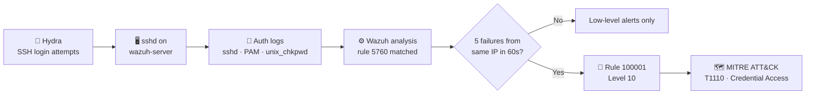

<div align="center">

# 🛡️ Wazuh SSH Brute-Force Detection

**Turning failed logins into a high-severity alert with a custom SIEM correlation rule**


</div>

---

## 📖 Overview

A single failed SSH login is noise. Five failed logins from the same IP within 60 seconds is a pattern.
This project turns raw authentication logs into an actionable alert using a custom Wazuh rule, then validates it with a simulated attack and investigates the result using the Threat Hunting and MITRE ATT&CK dashboards.

## 🧭 Detection Flow



## 🧪 Lab Setup

| Component | Details |
|---|---|
| SIEM | Wazuh (all-in-one: manager, indexer, dashboard) |
| Monitored host | `wazuh-server` (the Wazuh server's own local logs) |
| Log sources | sshd, PAM, unix_chkpwd, sudo |
| Attack tool | Hydra |

## 🔍 Detection Logic

Rule `100001` in [`rules/local_rules.xml`](rules/local_rules.xml):

```xml
<group name="local,sshd,authentication_failures,">
  <rule id="100001" level="10" frequency="5" timeframe="60">
    <if_matched_sid>5760</if_matched_sid>
    <same_source_ip />
    <description>Custom: 5 SSH failed logins from same IP within 60s</description>
    <mitre>
      <id>T1110</id>
    </mitre>
  </rule>
</group>
```

| Element | Purpose |
|---|---|
| `id="100001"` | Custom rules use IDs 100000 and above |
| `level="10"` | High-severity alert |
| `if_matched_sid` = 5760 | Builds on the built-in rule *sshd: authentication failed* |
| `frequency="5"` + `timeframe="60"` | Fires when the base rule matches 5 times within 60 seconds |
| `same_source_ip` | Counts failures only if they come from the same source IP |
| `<mitre><id>T1110</id>` | Tags the alert as Brute Force (Credential Access) |

## ⚔️ Attack Simulation

**Hydra** was used to send repeated failed SSH login attempts against the SSH service of the monitored host.
The failed attempts generated `sshd`, PAM and `unix_chkpwd` authentication-failure events, which Wazuh collected and correlated.
Rule 100001 raised a level-10 alert once the fifth failed SSH login (rule 5760) was seen within the 60-second window.

> ⚠️ This was a controlled test in my own lab. Only run such tools against systems you own or have permission to test.

## 📊 Results

Test window: Nov 3, 2026, 09:00 to 10:00.

| 🔔 Total alerts | 🔴 Auth failures | 🟢 Auth successes | 🚨 Level 12+ |
|:---:|:---:|:---:|:---:|
| **25** | **16** | **3** | **0** |

- ✅ Rule **100001** fired once at 09:04:33 (level 10, T1110, Credential Access), on the fifth `sshd: authentication failed` (rule 5760) event

### Alerts summary

| Rule ID | Description | Level | Count |
|---|---|:---:|:---:|
| 5557 | unix_chkpwd: Password check failed | 5 | 6 |
| 5760 | sshd: authentication failed | 5 | 5 |
| 5503 | PAM: User login failed | 5 | 4 |
| 5402 | Successful sudo to ROOT executed | 3 | 3 |
| 5501 | PAM: Login session opened | 3 | 3 |
| 5502 | PAM: Login session closed | 3 | 3 |
| 🚨 **100001** | **Custom: 5 SSH failed logins from same IP within 60s** | **10** | **1** |

## 🗺️ MITRE ATT&CK Mapping

| Tactic | Technique | ID |
|---|---|---|
| Credential Access | Brute Force | T1110 |

## 📸 Screenshots

| | |
|---|---|
|  |  |
| **MITRE Events:** rule 100001, T1110 | **Threat Hunting Dashboard:** 25 alerts, 16 failures |
|  |  |
| **MITRE Dashboard:** Brute Force / Credential Access | **Alerts Summary:** from the generated report |

📄 The full generated report is in [`reports/`](reports/).

## 🧩 Additional Rules (Experimental)

`local_rules.xml` also contains rules `100002` and `100003`, an auditd-based port scan detection (MITRE T1046).
**Status: experimental, not yet validated.** These rules were not triggered during the test above.

## 🚀 Limitations and Future Work

- [ ] Add an allow-list for trusted IPs (for example admin or monitoring hosts) to reduce false positives
- [ ] Wazuh **Active Response** to automatically block the attacker IP
- [ ] Email / Telegram notifications for level 10+ alerts
- [ ] Tune `frequency` and `timeframe` against real-world traffic

## 📁 Repository Structure

```
├── README.md
├── rules/local_rules.xml
├── screenshots/
└── reports/
```

---

<div align="center">

Built as a hands-on SOC / blue team learning project 🔐

</div>
